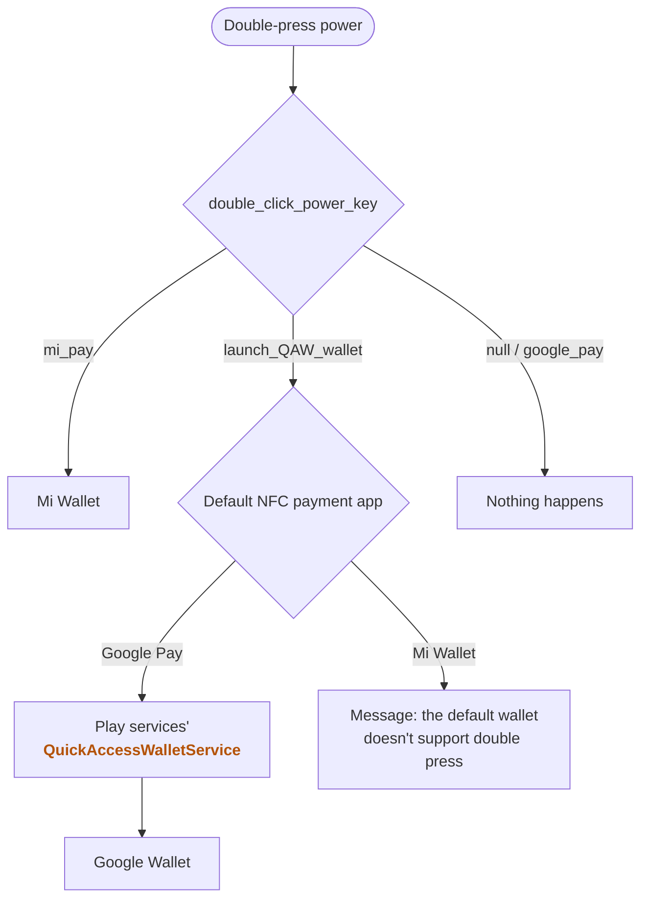
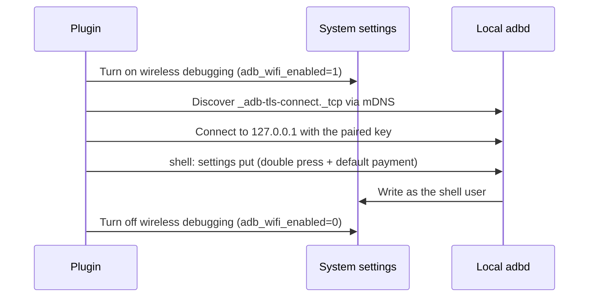
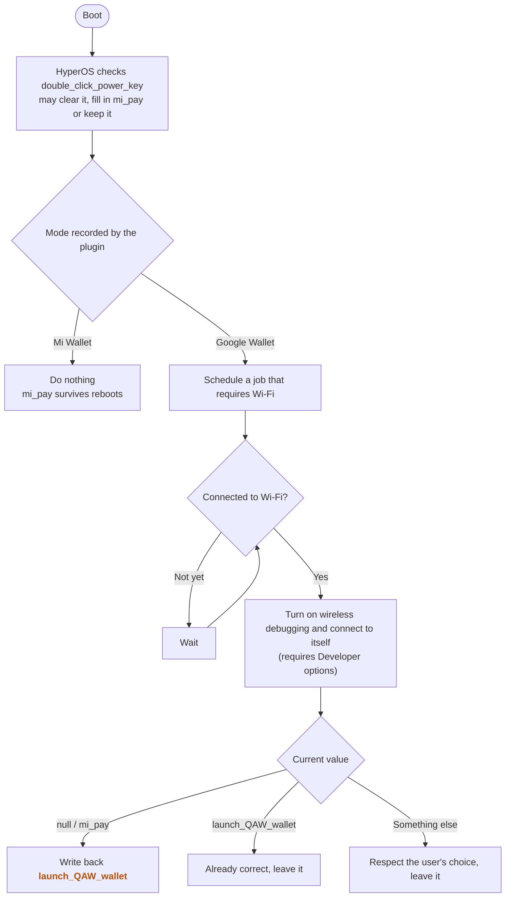

In my [previous post about FCM](/en/2026/02/20/xiaomi-china-version-fcm-push-debug/), I mentioned that I was getting ready to study abroad. Now that I'm actually overseas, I tap my card for almost everything—getting on the bus, buying coffee—so Google Wallet has become one of the most-used apps on my phone. But on the China version of HyperOS, "double-press the power button" can only open Mi Wallet. Every time I pull out my phone I have to unlock it, find the icon and tap it, which completely breaks the flow.

A few days ago I came across [DustinYe/PowerWallet](https://github.com/DustinYe/PowerWallet) on GitHub. Its tagline is literally "double-press the power button on a Xiaomi phone to open Google Wallet", no root required. Unfortunately it only supports one specific ROM build on the Xiaomi 13 Ultra. I forked it to port it to my Xiaomi 15, and after a fair amount of tinkering I realised that **on HyperOS 4, this really only takes one adb command**:

```bash
adb shell settings put system double_click_power_key launch_QAW_wallet
```

In the rest of this post, I'll go through "how stock Android works → what Xiaomi changed → what the original project did → what my fork does" to explain why this command works, and why I still ended up turning it into an app.

## Test Environment

- Xiaomi 15, China version (dada), HyperOS `OS4.0.0.22.XOCCNXM`, Android 17
- "Google basic services" enabled, Google Wallet installed with a card added, default NFC payment app set to Google Pay
- Bootloader locked, no root

## How Stock Android Works

Android 11 introduced a system interface called **Quick Access Wallet** (QAW): a wallet app implements a `QuickAccessWalletService`, and the system can launch it straight from the power menu, the lock screen or a gesture. For Google Wallet, this service is provided by Play services as `com.google.android.gms/.tapandpay.globalactions.WalletQuickAccessWalletService`.

Notably, QAW isn't tied to any particular wallet. Instead, it **first reads the default NFC payment app, then looks for a QAW service inside that app**. So "which wallet opens" is actually decided by the default payment app. Mi Wallet doesn't implement a QAW service: when I set the default payment app to Mi Wallet and double-pressed the power button, all I got was this message:

> 当前默认钱包不支持双击电源键打开，请修改设置
> (The current default wallet doesn't support opening with a double press of the power button. Please change your settings.)

In other words, `launch_QAW_wallet` can only open wallets that implement QAW, such as Google Wallet. It can't open Mi Wallet.

Later, stock Android also added an "open wallet" option to the "double-press power button" gesture, which corresponds to `double_tap_power_button_gesture=1` in the Secure settings table.

## What Xiaomi Changed

HyperOS doesn't use that stock setting directly. Instead, it uses its own `double_click_power_key` (in the System table) to decide what a double press does, then syncs the choice to the stock setting. You can see the sync in the logs:

```
MiuiSingKeyShortcutObserver: DTPB-Wallet syncAosp function=launch_QAW_wallet enabled=1 gesture=1
```

DTPB stands for Double Tap Power Button. The settings screen on the China version only offers options like Mi Wallet (`mi_pay`), transit codes and the camera, but the list of functions the system prints at boot also contains a `launch_QAW_wallet`:

```
ShortcutFunctionManager: init config,function=mi_pay, supportActions=[double_click_power_key]
ShortcutFunctionManager: init config,function=launch_QAW_wallet, supportActions=[double_click_power_key]
```

That's the stock "open wallet". It's missing from the China version's settings because a customisation config switches it off:

```
InputFeature: DTPB-Wallet support=false reason=disabledByCustFeature
```

The system also registers a `MIUI_REGION_CHANGED` broadcast receiver, so my guess is that this switch depends on the region. But the option is only hidden; nothing blocks it at runtime. After I manually set the value to `launch_QAW_wallet`, **a double press opened Google Wallet directly, both unlocked and on the lock screen**.

Putting stock Android and Xiaomi's logic together, here's what happens after a double press of the power button:



The other thing Xiaomi does is check this value at boot. If it decides the current value is "not supported", it clears it:

```
MiuiSingKeyShortcutObserver: set double_click_power_key to null, because function not support
```

## What the Original Project Did

The original project didn't know `launch_QAW_wallet` existed, so it took a long detour:

1. Set `double_click_power_key` to `google_pay`, a value the system doesn't recognise, so the system's double-press action does nothing;
2. Use adb to start a long-running process via `app_process` as the shell user, which listens for power-key presses and releases with `getevent` and detects double presses itself;
3. On a double press, open Google Wallet's tap-to-pay screen with `am start`, with a companion app handling the lock-screen state.

It's a clever idea, but it has two problems: the long-running process is gone after a reboot, so you have to connect to a computer and reactivate it after every restart; and on HyperOS 4, an unrecognised value like `google_pay` also gets cleared by the system at boot. I started by porting this approach as-is. It was only while chasing down a bug where "the original value in the backup mysteriously turned into `null`" that I stumbled onto the boot-time cleanup and then `launch_QAW_wallet`.

## What My Fork Does

At its core, it's just the command from the start of this post. What my fork does is fill in three things around that command:

### 1. Use the native launch_QAW_wallet

No long-running process, no lock-screen handling of our own; the system takes care of everything. Mi Wallet mode simply writes the value back to `mi_pay`.

### 2. Switch the default NFC payment app along with the mode

The default payment app is stored in `settings secure nfc_payment_default_component`. On the Google side it's `com.google.android.gms/.tapandpay.hce.service.TpHceService`; Mi Wallet is `com.android.nfc/.cardemulation.ESEWalletDummyService` (it uses the eSE). Switching to Google Wallet mode sets the default payment app to Google Pay, and switching to Mi Wallet mode sets it to Mi Wallet. If you've chosen a third-party payment app, it's left alone.

As mentioned above, QAW opens the wallet of the default payment app, so this step isn't just a nice extra: **each mode is a pair of settings, and both have to match**.

| Mode | `double_click_power_key` | Default NFC payment app |
| --- | --- | --- |
| Google Wallet | `launch_QAW_wallet` | Google Pay |
| Mi Wallet | `mi_pay` | Mi Wallet |

This matters especially when switching back to Mi Wallet. Changing only the default payment app isn't enough—a double press just shows "the current default wallet doesn't support opening with a double press of the power button". **You must also set `double_click_power_key` back to `mi_pay`**, and that step needs adb too.

If adb isn't convenient at that moment (for example, you've already turned off Developer options), there's a fallback that doesn't need adb: in system settings, go to Accessibility → General → Shortcut gestures → Double-press power button (「辅助功能 → 通用 → 快捷手势 → 双击电源键」) and switch it back to "Transit / Mi Pay / Door card" (「公交 / Mi Pay / 门卡」). The plugin won't know you did this, though: if it still has Google Wallet mode recorded, it will set the value back to `launch_QAW_wallet` the next time the phone boots with adb available. So if you want Mi Wallet long-term, switch in the plugin when you get the chance.

### 3. Let the app run the command itself

This command has to run as the shell user; a normal app can't write the setting:

```
You cannot keep your settings in the secure settings.
```

`double_click_power_key` isn't a public setting. SettingsProvider only lets system, shell, root and preinstalled privileged apps change it, and any normal app targeting an SDK above 22 is rejected outright—**even after being granted `WRITE_SECURE_SETTINGS` via `pm grant`**.

So, following the approach of Ice Box and Shizuku, I had the plugin act as its own adb client and connect to the phone's own wireless debugging to get a shell:

- **First-time setup**: In Developer options → Wireless debugging, tap "Pair device with pairing code", then enter the 6-digit code in the plugin's notification. Once paired, the plugin uses the shell to `pm grant` itself `WRITE_SECURE_SETTINGS`.
- **Switching modes**: The plugin uses that permission to turn on wireless debugging (`adb_wifi_enabled` is in the Global table, which it *can* write), finds the local adbd port via mDNS, connects to itself, runs `settings put`, then turns wireless debugging off again. The whole thing takes about 5 seconds.
- **Restoring after boot**: After boot, it schedules a JobScheduler job that requires Wi-Fi. If you're in Google Wallet mode and the value after boot is `null` or `mi_pay`, it writes `launch_QAW_wallet` back; if it's some other function (say you set it to the camera in system settings), it leaves it alone. At boot there's no way to tell "`mi_pay` filled in by the system" from "`mi_pay` chosen by the user", so if you want Mi Wallet long-term, switch to it in the plugin—`mi_pay` survives reboots on its own.

Here's roughly what happens when the plugin switches modes:



And this is how the boot restore decides what to do:



**To be clear, this approach doesn't get around adb.** The plugin just turns on wireless debugging for you. Both switching modes and restoring after boot need adb shell access at that moment, which means Developer options and USB debugging / wireless debugging must be on. This is essentially the same as the original project's "reactivate via adb after every reboot"—it just removes the computer from the picture.

## About the adb Client

Wireless debugging pairing and connection involve protocol details like SPAKE2 and TLS. Honestly, I don't fully understand them myself; I left that code entirely to AI, working from the AOSP adb source, and my job was testing on a real device, reading logs and reporting problems. If you're curious, the code is in the repository.

There's only one thing worth mentioning for actual use: HyperOS freezes an app the moment it goes to the background (the log says `freezeUid SUCCESS ... reason=tobg`). My first test got stuck exactly at the step where I switched to Settings to find the pairing code. So make sure to allow "Autostart" for the plugin and set its battery saver to "No restrictions".

## Test Results

| Item | Result |
| --- | --- |
| `launch_QAW_wallet` opens Google Wallet | Passed, both unlocked and locked |
| `mi_pay` opens Mi Wallet | Passed |
| Default NFC payment app follows the mode | Passed; the preferred payment service in `dumpsys nfc` changes immediately |
| Switching modes in the plugin (wireless debugging toggled automatically) | Passed, about 5 seconds |
| Full boot-restore chain | Passed: boot broadcast → wait for network → turn on wireless debugging → connect → run → turn off wireless debugging |
| Boot-restore rules (`mi_pay` / `null` / `launch_camera`) | The first two are rewritten to `launch_QAW_wallet`; the last is left unchanged |
| `launch_QAW_wallet` with Mi Wallet as the default payment app | Can't open Mi Wallet; shows "the current default wallet doesn't support opening with a double press of the power button. Please change your settings." |

Not yet tested:

- Booting without Wi-Fi and connecting a while later
- The full flow from pairing onwards on a fresh install
- Paying at a real card reader

## Things to Note

- **Everything depends on Developer options.** Many people keep Developer options off day to day; banking apps such as HSBC HK, for example, refuse to run on a phone with Developer options enabled. If that's you: while it's off, you can't switch modes through the plugin, and if you need Mi Wallet you'll have to go to Accessibility → General → Shortcut gestures → Double-press power button and switch back to "Transit / Mi Pay / Door card" manually; Mi Wallet mode isn't affected by reboots; but Google Wallet mode may be cleared by the system after a reboot, and a double press won't open Google Wallet until you turn Developer options back on and connect to Wi-Fi so the plugin can write it back. I also haven't verified whether turning off Developer options revokes the granted `WRITE_SECURE_SETTINGS` and the wireless debugging pairing.
- **Wi-Fi is required.** Wireless debugging only works over Wi-Fi.
- **The pairing can expire.** By default, Android revokes wireless debugging keys that haven't connected for 7 days. Fortunately, every mode switch and boot restore counts as a connection. If it does expire, just enter a pairing code in the notification again.
- **The plugin now has network permission.** It only connects to adbd on `127.0.0.1`, but it holds a key that adbd trusts, so it can get a shell whenever wireless debugging is on. If that bothers you, use "Revoke USB debugging authorisations" in Developer options.
- **If you'd rather not install the plugin**, just run the command from the start of this post once by hand—you may need to run it again after a reboot.

## Conclusion

The China version of HyperOS 4 already hides the ability to open Google Wallet with a double press of the power button: it's stock Android's Quick Access Wallet, called `launch_QAW_wallet` in HyperOS. It just isn't exposed in the settings screen, and the system itself may clear it at boot.

So the whole thing really comes down to **using adb permissions to change the `double_click_power_key` setting**, and matching the default payment app to it. Going the other way, if you want Mi Wallet you also have to set it back to `mi_pay`, because `launch_QAW_wallet` can't open Mi Wallet. My fork just automates *when* that command runs: pair once, and from then on switching modes and restoring after boot don't need a computer—as long as Developer options stay on, which isn't great for anyone who has to turn Developer options off to use their banking apps.

As for why Quick Access Wallet is marked `disabledByCustFeature` on China ROMs yet works perfectly at runtime—<span class="heimu">probably because nobody uses Google Wallet on a China-version phone</span>.

## See Also

- [zhullyb/PowerWallet: the fork this post is about](https://github.com/zhullyb/PowerWallet)
- [DustinYe/PowerWallet: double-press the power button on a Xiaomi phone to open Google Wallet](https://github.com/DustinYe/PowerWallet)
- [Android Developers - QuickAccessWalletService](https://developer.android.com/reference/android/service/quickaccesswallet/QuickAccessWalletService)
- [Ice Box - Wireless debugging activation (Chinese)](https://icebox.catchingnow.com/zh-hans/guide/wireless-debugging/)
