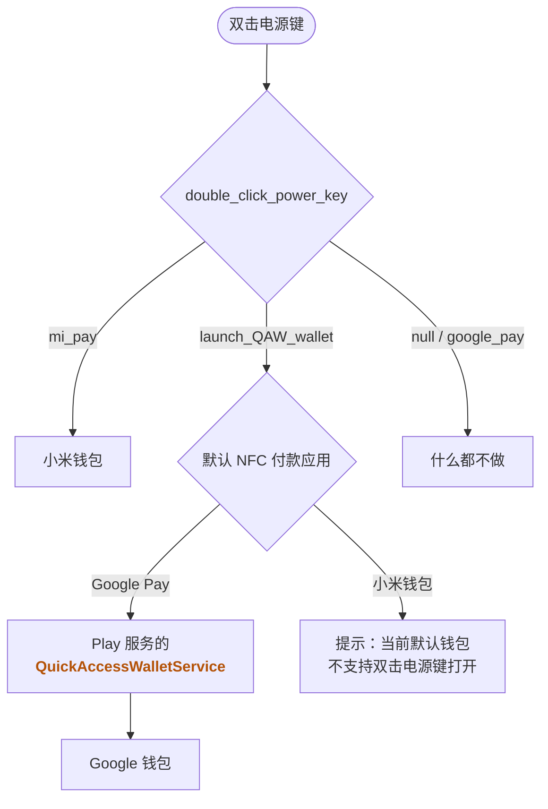
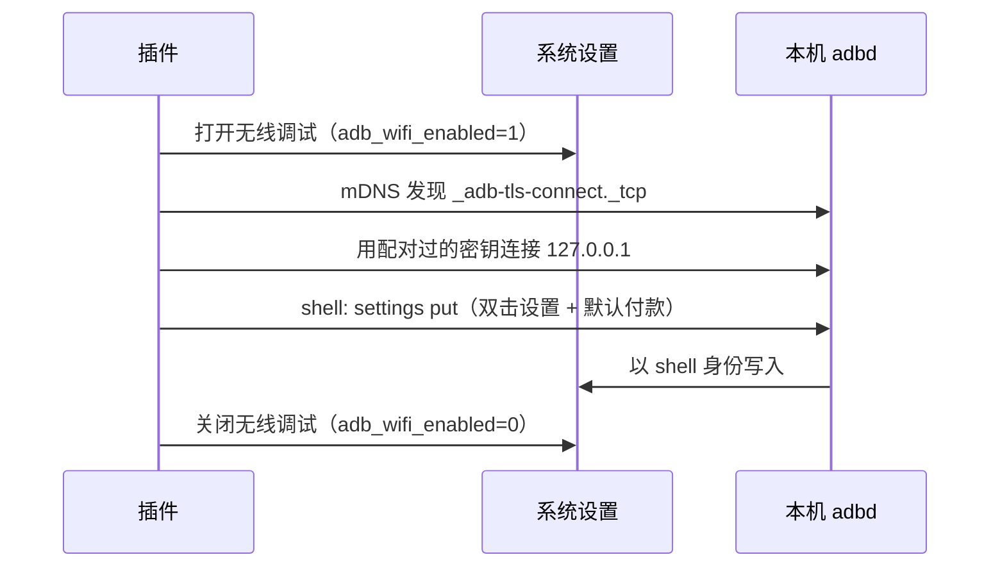
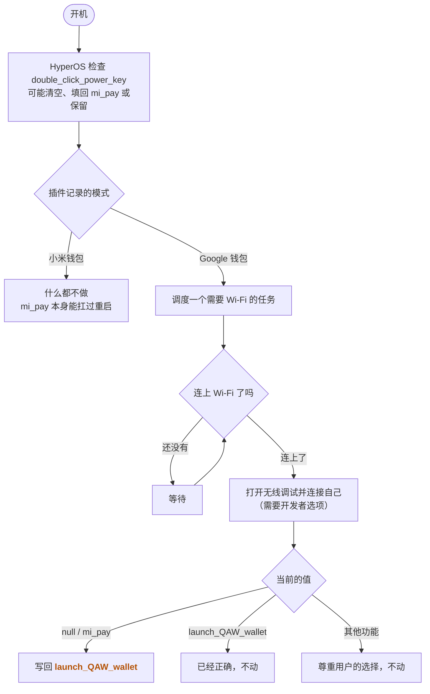

在[上一篇关于 FCM 的文章](/2026/02/20/xiaomi-china-version-fcm-push-debug/)里我提到，我已经在为出国做准备了。现在人已经到了海外，日常坐车、买咖啡基本都是刷卡，Google 钱包就成了我手机上使用频率最高的 App 之一。但国行 HyperOS 的「双击电源键」只能打开小米钱包，每次掏出手机还得解锁、找图标、点开，节奏一下就被打乱了。

前几天我在 GitHub 上看到了 [DustinYe/PowerWallet](https://github.com/DustinYe/PowerWallet) 这个项目，标题就是「双击小米手机电源键，直接打开 Google 钱包」，免 root，可惜只适配了小米 13 Ultra 的某一个 ROM 版本。我 fork 了一份打算搬到小米 15 上，折腾了一圈以后发现，**这件事在 HyperOS 4 上其实只需要一条 adb 命令**：

```bash
adb shell settings put system double_click_power_key launch_QAW_wallet
```

剩下的篇幅，我按「原生 Android 的机制 → 小米做了什么 → 原项目做了什么 → 我的 fork 做了什么」的顺序讲清楚这条命令为什么有效，以及为什么最后还是要做成一个 App。

## 测试环境

- 小米 15 国内版（dada），HyperOS `OS4.0.0.22.XOCCNXM`，Android 17
- 已开启「谷歌基础服务」，Google 钱包已安装并绑卡，默认 NFC 付款应用为 Google Pay
- 未解锁 Bootloader，无 root

## 原生 Android 的机制

Android 11 引入了一套叫 **Quick Access Wallet**（QAW，快速访问钱包）的系统接口：钱包应用实现一个 `QuickAccessWalletService`，系统就能在电源菜单、锁屏或者手势里直接调起它。Google 钱包的这个服务由 Play 服务提供，叫 `com.google.android.gms/.tapandpay.globalactions.WalletQuickAccessWalletService`。

值得注意的是，QAW 并不绑定某个特定的钱包，而是**先读取默认 NFC 付款应用，再去这个应用里找 QAW 服务**。所以「打开哪个钱包」其实是由默认付款应用决定的。小米钱包并没有实现 QAW 服务，我实测把默认付款应用改成小米钱包以后，双击电源键只会弹出一句提示：

> 当前默认钱包不支持双击电源键打开，请修改设置

也就是说，`launch_QAW_wallet` 只能用来打开 Google 钱包这类实现了 QAW 的钱包，打不开小米钱包。

后来原生 Android 又在「双击电源键」这个手势上加入了「打开钱包」的选项，对应 Secure 表里的 `double_tap_power_button_gesture=1`。

## 小米做了什么

HyperOS 并不直接使用原生的那个设置，而是用自己的 `double_click_power_key`（位于 System 表）来决定双击电源键做什么，再同步给原生设置。日志里能看到这个同步过程：

```
MiuiSingKeyShortcutObserver: DTPB-Wallet syncAosp function=launch_QAW_wallet enabled=1 gesture=1
```

DTPB 就是 Double Tap Power Button。国行的设置界面里只能选小米钱包（`mi_pay`）、乘车码、相机等选项，但系统开机时打印的功能列表里，其实还有一个 `launch_QAW_wallet`：

```
ShortcutFunctionManager: init config,function=mi_pay, supportActions=[double_click_power_key]
ShortcutFunctionManager: init config,function=launch_QAW_wallet, supportActions=[double_click_power_key]
```

它就是原生的「打开钱包」。国行之所以看不到这个选项，是因为它被定制配置关掉了：

```
InputFeature: DTPB-Wallet support=false reason=disabledByCustFeature
```

系统还注册了 `MIUI_REGION_CHANGED` 广播，我猜这个开关是按地区下发的。但它只是被藏了起来，运行时并没有人拦它：我手动把值改成 `launch_QAW_wallet` 以后，**解锁和锁屏状态下双击都直接打开了 Google 钱包**。

把原生 Android 和小米的逻辑放在一起，双击电源键之后发生的事情是这样的：



小米做的另一件事，是在开机时检查这个值。如果它认为当前的值「不支持」，就会把它清掉：

```
MiuiSingKeyShortcutObserver: set double_click_power_key to null, because function not support
```

## 原项目做了什么

原项目当时并不知道 `launch_QAW_wallet` 的存在，所以绕了一个大圈：

1. 把 `double_click_power_key` 改成一个系统不认识的值 `google_pay`，让系统的双击动作失效；
2. 通过 adb 用 `app_process` 启动一个以 shell 身份运行的常驻进程，用 `getevent` 监听电源键的按下与抬起，自己识别双击；
3. 识别到双击后，用 `am start` 打开 Google 钱包的刷卡页，锁屏时再配合配套 App 处理解锁状态。

思路很巧妙，但有两个问题：这个常驻进程重启后就没了，每次重启都要连电脑重新激活；而在 HyperOS 4 上，`google_pay` 这种不认识的值同样会在开机时被系统清掉。我一开始就是先把这套方案原样搬了过来，后来在排查一个「备份里的原值莫名变成 `null`」的问题时，才顺藤摸瓜发现了开机清理和 `launch_QAW_wallet`。

## 我的 fork 做了什么

说穿了，核心就是开头那条命令。我的 fork 做的是在这条命令周围补齐三件事：

### 1. 改用原生的 launch_QAW_wallet

不再需要常驻进程，也不用自己处理锁屏，全部交给系统。小米钱包模式就是把值写回 `mi_pay`。

### 2. 切换模式时同步默认 NFC 付款应用

默认付款应用存在 `settings secure nfc_payment_default_component` 里。Google 一侧是 `com.google.android.gms/.tapandpay.hce.service.TpHceService`，小米钱包则是 `com.android.nfc/.cardemulation.ESEWalletDummyService`（走的是 eSE）。切换到 Google 钱包模式时把默认付款改成 Google Pay，切换到小米钱包模式时改成小米钱包；如果你选的是第三方付款应用，就不动它。

前面说过，QAW 打开的是默认付款应用的钱包，所以这一步不只是顺手：**两种模式各自对应一组设置，缺一不可**。

| 模式 | `double_click_power_key` | 默认 NFC 付款应用 |
| --- | --- | --- |
| Google 钱包 | `launch_QAW_wallet` | Google Pay |
| 小米钱包 | `mi_pay` | 小米钱包 |

尤其是切回小米钱包的时候，只改默认付款应用是不够的，双击会提示「当前默认钱包不支持双击电源键打开」，**必须把 `double_click_power_key` 也改回 `mi_pay`**，而这一步同样需要 adb。

如果那时恰好不方便用 adb（比如已经把开发者选项关了），还有一条不需要 adb 的退路：在系统设置的「辅助功能 → 通用 → 快捷手势 → 双击电源键」里，把它改回「公交 / Mi Pay / 门卡」。不过插件并不知道你这么改过，如果它记录的仍是 Google 钱包模式，下次开机并具备 adb 条件时，它会把值改回 `launch_QAW_wallet`。所以想长期使用小米钱包，最好还是在方便的时候到插件里切换一次。

### 3. 让 App 自己执行这条命令

这条命令必须由 shell 来执行，普通 App 是写不了的：

```
You cannot keep your settings in the secure settings.
```

`double_click_power_key` 不是公开的设置项，SettingsProvider 只允许 system、shell、root 和预装的特权应用修改它，普通应用只要 targetSdk 高于 22 就会被拒绝，**即使已经通过 `pm grant` 拿到了 `WRITE_SECURE_SETTINGS` 也不行**。

所以我参考冰箱（Ice Box）、Shizuku 的做法，让插件自己扮演 adb 客户端，连接本机的无线调试来拿到 shell 权限：

- **首次设置**：在开发者选项的「无线调试」里点「使用配对码配对设备」，然后在插件的通知里输入 6 位配对码。配对完成后，插件通过 shell 给自己 `pm grant` 一个 `WRITE_SECURE_SETTINGS`。
- **切换模式**：插件用这个权限打开无线调试（`adb_wifi_enabled` 位于 Global 表，这个是能写的），通过 mDNS 找到本机 adbd 的端口，连上自己，执行 `settings put`，再把无线调试关掉，整个过程大约 5 秒。
- **开机写回**：开机后调度一个要求连接 Wi-Fi 的 JobScheduler 任务。如果你选的是 Google 钱包模式，开机后的值是 `null` 或 `mi_pay`，就写回 `launch_QAW_wallet`；如果是其他功能（比如你在系统设置里改成了相机），就不动。开机时无法区分「系统填回的 `mi_pay`」和「用户选的 `mi_pay`」，所以想长期用小米钱包的话，请在插件里切换，`mi_pay` 本身就能扛过重启。

插件切换模式的过程大致如下：



开机写回的判断逻辑则是这样的：



**需要强调的是，这个方案并没有绕开 adb。** 插件只是替你临时打开无线调试，不管是切换模式还是开机写回，那一刻都需要 adb shell 权限，也就是必须开着「开发者选项」和「USB 调试 / 无线调试」。这和原项目「每次重启都要 adb 激活一次」本质上是一样的，只是把电脑省掉了。

## 关于 adb 客户端的实现

无线调试的配对和连接涉及 SPAKE2、TLS 之类的协议细节，说实话我自己也不是那么懂，这部分代码全部交给 AI 照着 AOSP 的 adb 源码写的，我只负责在真机上测试、看日志、反馈问题。感兴趣的朋友可以直接去仓库里看代码。

实际使用中值得一提的只有一点：HyperOS 会在 App 切到后台的瞬间把它冻结（日志里是 `freezeUid SUCCESS ... reason=tobg`），我第一次测试时就卡在了切去设置页找配对码的那一步。所以一定要给插件允许「自启动」，并把省电策略设为「无限制」。

## 测试结果

| 项目 | 结果 |
| --- | --- |
| `launch_QAW_wallet` 打开 Google 钱包 | 解锁、锁屏均通过 |
| `mi_pay` 打开小米钱包 | 通过 |
| 默认 NFC 付款应用随模式切换 | 通过，`dumpsys nfc` 中的首选付款服务立即变化 |
| 插件内切换模式（自动开关无线调试） | 通过，约 5 秒 |
| 开机写回完整链路 | 通过：开机广播 → 等待网络 → 打开无线调试 → 连接 → 执行 → 关闭无线调试 |
| 开机写回规则（`mi_pay` / `null` / `launch_camera`） | 前两者写回 `launch_QAW_wallet`，后者保持不变 |
| 默认付款为小米钱包时使用 `launch_QAW_wallet` | 无法打开小米钱包，提示「当前默认钱包不支持双击电源键打开，请修改设置」 |

还没有测试的：

- 开机时没有 Wi-Fi、过一会儿才连上的情况
- 全新安装后从配对开始的完整流程
- 真实读卡器付款

## 一些注意事项

- **全程依赖开发者选项**。很多人日常会关闭开发者选项，比如 HSBC HK 这类银行 App 就不允许在开启开发者选项的手机上使用。如果你也是这样：关闭期间无法通过插件切换模式，需要小米钱包时只能去「辅助功能 → 通用 → 快捷手势 → 双击电源键」手动改回「公交 / Mi Pay / 门卡」；小米钱包模式重启后不受影响；但 Google 钱包模式在重启后可能被系统清掉，在你重新打开开发者选项、连上 Wi-Fi 让插件写回之前，双击都不会打开 Google 钱包。另外，关闭开发者选项后，已授予的 `WRITE_SECURE_SETTINGS` 和无线调试配对会不会被收回，我还没有验证。
- **需要 Wi-Fi**。无线调试只能在 Wi-Fi 下工作。
- **配对可能过期**。Android 默认会撤销 7 天内没有连接过的无线调试密钥，好在每次切换和开机写回都会连一次。万一过期了，在通知栏重新输入一次配对码就行。
- **插件有网络权限了**。它只连接 `127.0.0.1` 上的 adbd，但持有一把被 adbd 信任的密钥，无线调试开着的时候可以随时拿到 shell。介意的话，可以在开发者选项里「撤销 USB 调试授权」。
- **不想装插件的话**，开头那条命令手动执行一次就行，只是重启后可能需要再执行一次。

## 结论

国行 HyperOS 4 自己就藏着「双击电源键打开 Google 钱包」的能力：它就是原生 Android 的 Quick Access Wallet，HyperOS 里叫 `launch_QAW_wallet`，只是没在设置界面里露出来，开机时还可能被系统自己清掉。

所以整件事说穿了，就是**用 adb 权限改一下 `double_click_power_key` 这个设置**，再把默认付款应用对应好。反过来想用小米钱包时，也得把它改回 `mi_pay`，因为 `launch_QAW_wallet` 打不开小米钱包。我的 fork 只是把「什么时候执行这条命令」自动化了：配对一次，以后切换模式和开机写回都不需要电脑，但前提是开发者选项一直开着，这对需要关闭开发者选项才能用银行 App 的朋友来说并不友好。

至于为什么 Quick Access Wallet 在国行被标记为 `disabledByCustFeature`，却在运行时完全可用——<span class="heimu">大概是因为没人会在国行手机上用 Google 钱包吧</span>。

## 参见

- [zhullyb/PowerWallet: 本文对应的 fork](https://github.com/zhullyb/PowerWallet)
- [DustinYe/PowerWallet: 双击小米手机电源键打开 Google 钱包](https://github.com/DustinYe/PowerWallet)
- [Android Developers - QuickAccessWalletService](https://developer.android.com/reference/android/service/quickaccesswallet/QuickAccessWalletService)
- [冰箱 IceBox - 无线调试激活](https://icebox.catchingnow.com/zh-hans/guide/wireless-debugging/)
